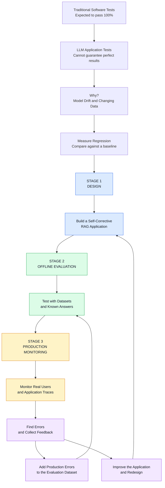
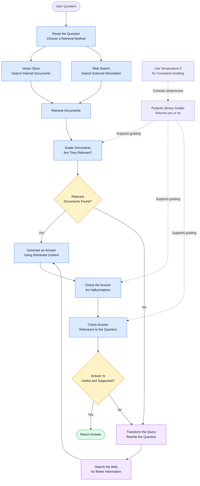
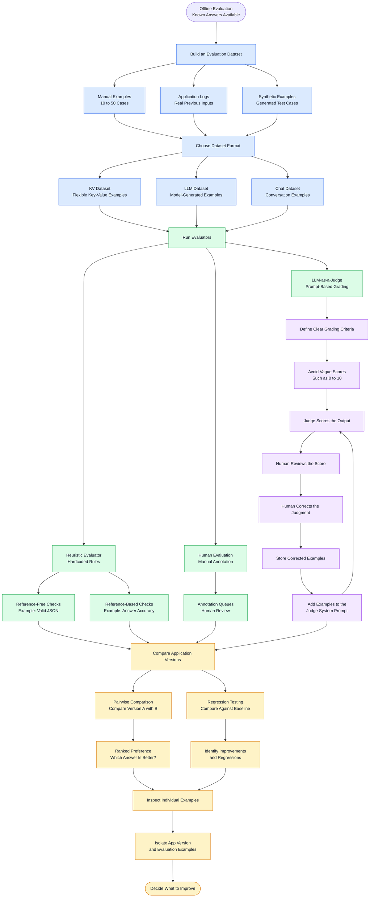
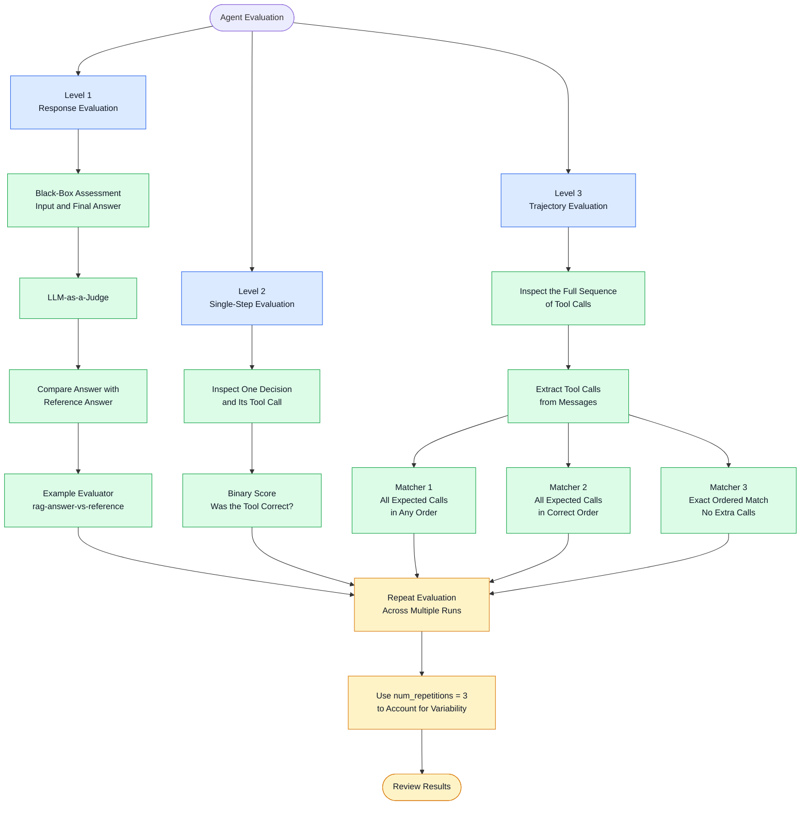
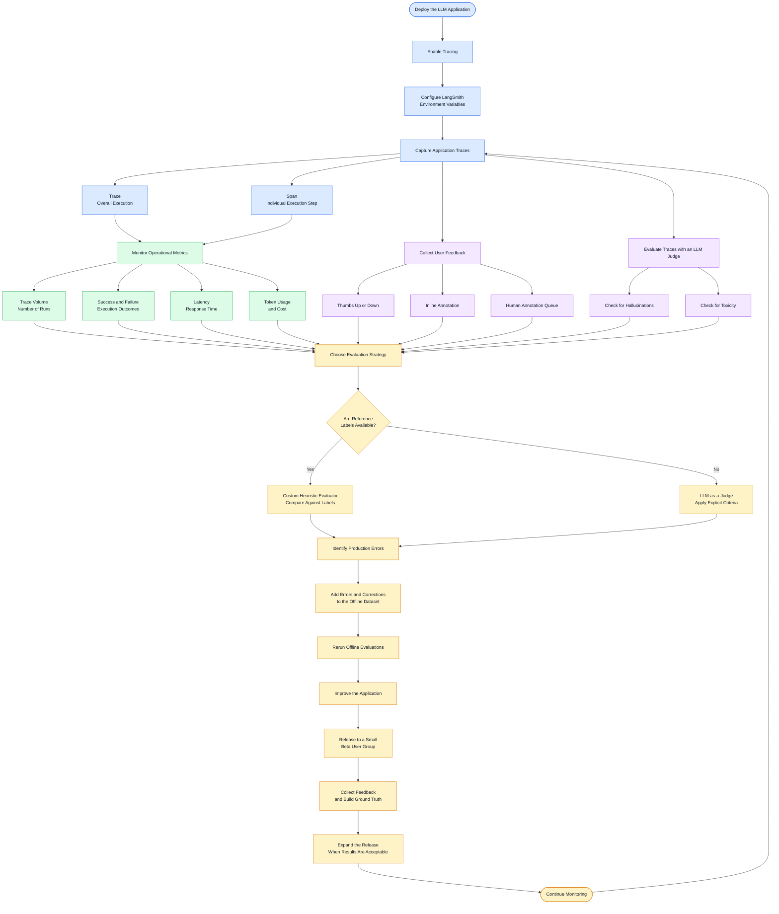

**complete Mermaid flowchart with wrapped text, shorter node labels, and improved spacing** to prevent text from being cut off.

I've divided the content into **4 diagrams** so they remain readable instead of squeezing everything into one massive flowchart.

**Important:** Copy the code directly into Mermaid Live Editor. Start with `%%{init...` and do not include Markdown backticks.

## 1. LLM Evaluation: The Big Picture



## 2. Stage 1: Self-Corrective RAG

This diagram shows how an application retrieves documents, grades them, generates an answer, and falls back to web search when needed.



**Key takeaway:** A binary grader returns a clear `yes` or `no`, allowing application code to make routing decisions. Setting temperature to `0` reduces randomness but does not guarantee identical results in every environment.

## 3. Stage 2: Offline Evaluation and Agent Testing

This diagram covers dataset creation, evaluator types, judge improvement, regression testing, and agent evaluation.



### Agent evaluation: three levels

Agents are nondeterministic, so evaluating only their final answers may miss important problems.



**Remember the difference:**

* **Response evaluation:** Is the final answer good?
* **Single-step evaluation:** Was the tool choice correct?
* **Trajectory evaluation:** Did the agent follow the correct sequence of actions?

The evaluator `rag-answer-vs-reference` is an example of an evaluator configuration, not a universal requirement. In LangSmith, the exact evaluator name and availability depend on the project and configuration.

## 4. Stage 3: Production Monitoring and the Feedback Loop

Production monitoring usually has no known correct answer for every user request. Instead, you inspect traces, measure operational metrics, collect feedback, and apply suitable evaluators.



### Production tracing setup

For a typical LangSmith tracing setup, the environment variables look like this:

```bash
export LANGCHAIN_TRACING_V2=true
export LANGCHAIN_API_KEY="your_langsmith_api_key"
```

Set your API key securely in your environment rather than hardcoding it in source code. You may also need to configure the project name and other settings for your application.

### The complete feedback loop

The most important concept across all four diagrams is:

**Design → Test → Deploy → Monitor → Learn → Improve → Test Again**

